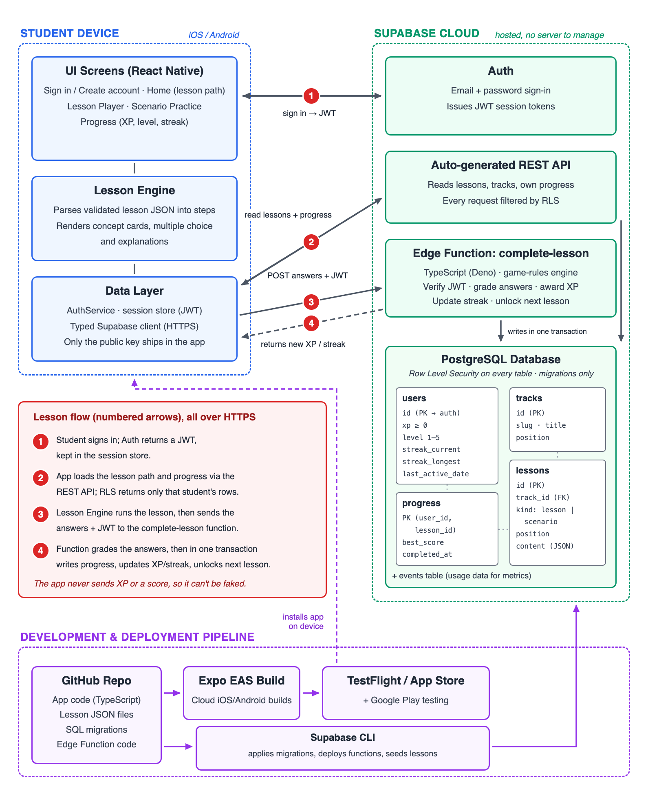

# DesignReps

**Show up daily. Design better.**

A Duolingo-style mobile app for practicing **system design** for software-engineering interviews. Short, daily, gamified lessons cover the core concepts (scaling, caching, load balancing, databases), plus guided exercises on classic prompts like *design a URL shortener*. Streaks, XP and levels turn system design into a habit instead of a last-minute cram.

> 🚧 In active development. MVP targeting the iOS App Store, with Android as a secondary target.

## Why I'm building it

Coding interviews have LeetCode for daily practice. System design has scattered videos and long-form reading. DesignReps aims to be the daily practice tool for system design, built for students and early-career engineers who are preparing for their first system design round.

## Engineering highlights

The backend is the main technical focus. The mobile app is intentionally a thin client.

**Built so far:** the database schema (via migrations), email/password sign-in with protected screens, the game-rules engine (XP, levels, streaks, unlocking), the lesson content format and its validator, and the app ↔ Supabase foundation, all covered by 120+ unit tests. **In progress:** the `complete-lesson` Edge Function, Row Level Security policies, the lesson screen and the first lessons.

- **Server-authoritative game logic.** XP, streaks, levels and lesson unlocks are computed on the server, never on the device: the app sends the user's answers, not a score. A modified client can't award itself points.
  - The rules live in a pure, deterministic engine (`supabase/functions/_shared/game`) that runs both in the Edge Function (Deno) and in the unit tests. Streaks follow the user's own time zone.
  - The database enforces them too: XP can't go negative, levels are 1–5, and the `progress (user_id, lesson_id)` primary key means XP is awarded at most once per lesson, even for duplicate or simultaneous submissions.
- **Security by design.**
  - PostgreSQL Row Level Security on every table: users can read and write only their own rows, and no client can write XP or streak values directly.
  - The app ships only a public, RLS-restricted key. It **refuses to start** if a privileged (`secret` / `service_role`) key is ever configured, which catches that mistake before it can reach a release build.
- **Data-driven lessons.** Lessons are structured JSON, validated against a schema in the test suite (exactly 5 questions, a correct answer that exists, cited sources), and rendered by shared components. A new topic or a whole new track is a content change rather than new screens or schema changes.
- **Reproducible backend.**
  - A normalized 5-table schema (`users`, `tracks`, `lessons`, `progress`, `events`) built only through version-controlled SQL migrations.
  - Lessons are loaded by a seed script.
  - The full backend can be rebuilt from the repo on a fresh project.
- **Tested and measured.**
  - 120+ unit tests today: auth, input validation, lesson format, and the game rules, which are mapped one-to-one to the API contract's test plan.
  - Planned: 20+ Edge Function tests and 10+ Row Level Security tests.
  - Performance target: 95% of `complete-lesson` calls finish in under 1 s, with load testing at 50 concurrent users.
- **Clean architecture.** Screens stay thin; domain logic lives in small, dependency-injected TypeScript classes that are unit tested without a network or device.

## Tech stack

| Layer | Technology |
|---|---|
| Mobile | React Native 0.88, Expo SDK 58, TypeScript, Expo Router |
| Backend | Supabase: PostgreSQL, Auth, Row Level Security, Edge Functions (TypeScript/Deno) |
| Testing | Jest (app and shared game rules), Deno test runner and SQL tests (backend, planned) |
| Delivery | Expo EAS Build/Submit, TestFlight, App Store |

## Architecture

1. The student signs in; Supabase Auth returns a JWT session token.
2. The app reads lessons and the student's own progress through Supabase's REST API. Row Level Security filters every query to that student's rows.
3. When a lesson ends, the app sends the **answers** (not a score) with the token to the `complete-lesson` Edge Function ([API contract](api/complete-lesson.md)).
4. The function grades the answers, applies the game rules, and in **one transaction** records progress, updates XP and the streak, unlocks the next lesson, and logs an anonymous usage event.

## Engineering practices

- Every feature and fix ships on its own branch through a pull request; releases are tagged.
- Type-check, lint and tests run before every merge.
- API behavior is specified first ([`api/complete-lesson.md`](api/complete-lesson.md)), then implemented and tested against that contract.
- The schema changes only through migrations in [`supabase/migrations`](supabase/migrations); the lesson format is documented in [`content/README.md`](content/README.md).
- No secrets in the repository. Build-time and server secrets live in EAS and Supabase secret stores.
